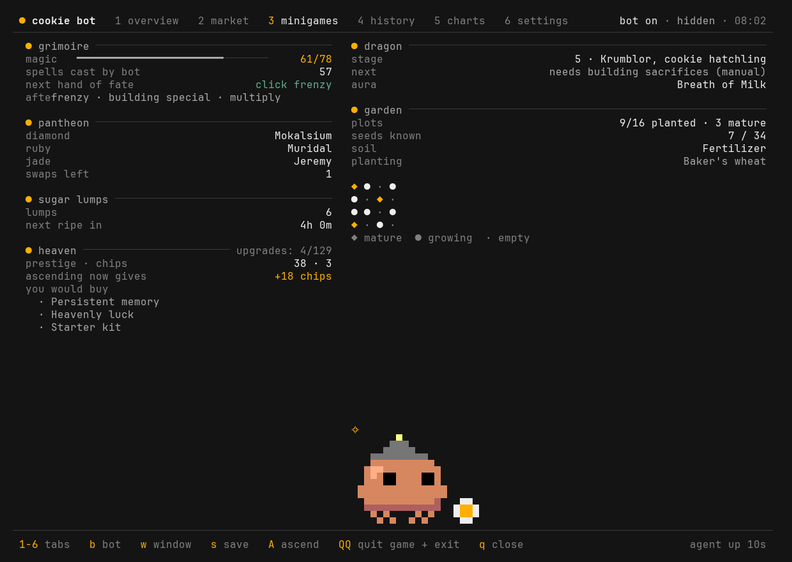
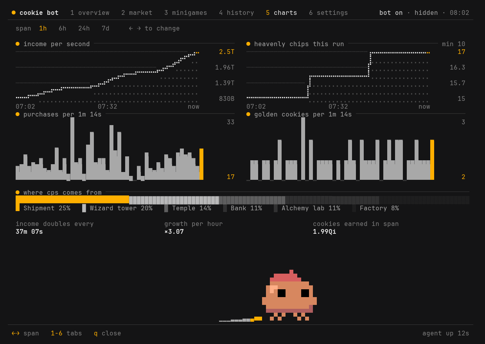
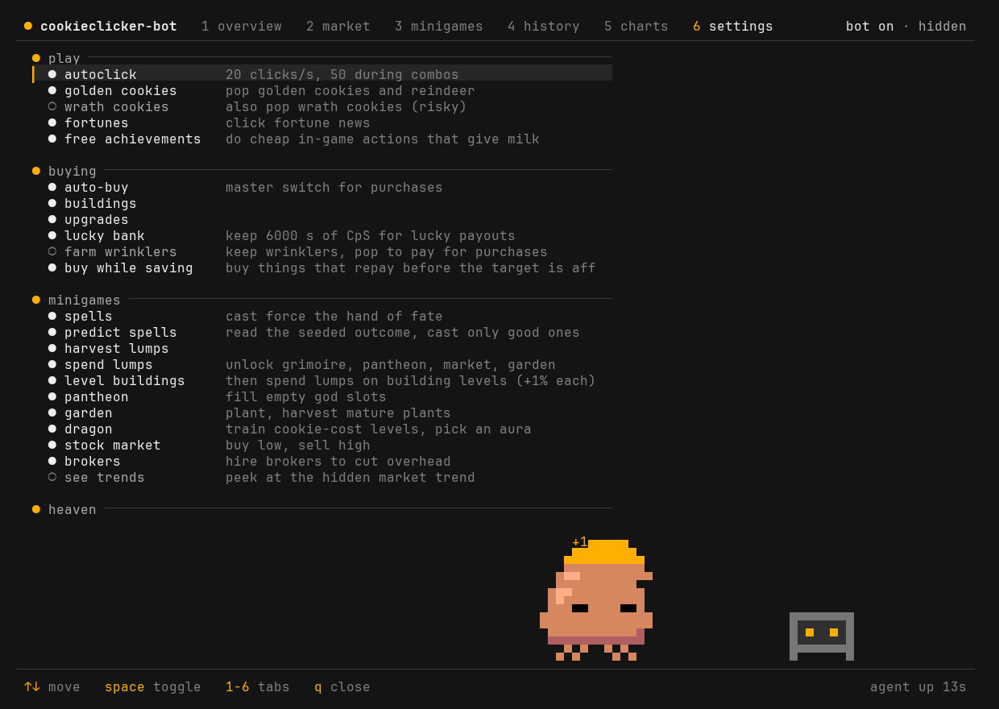
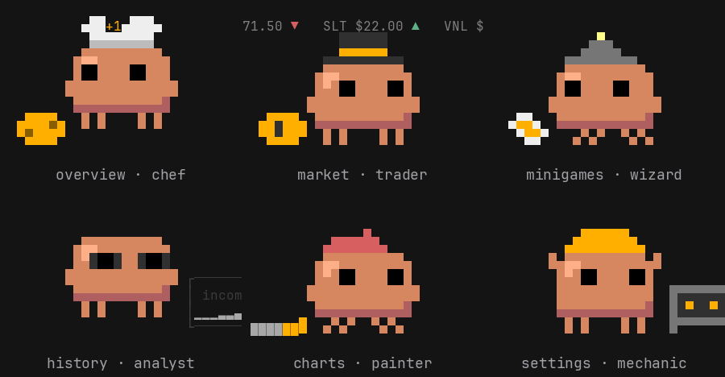
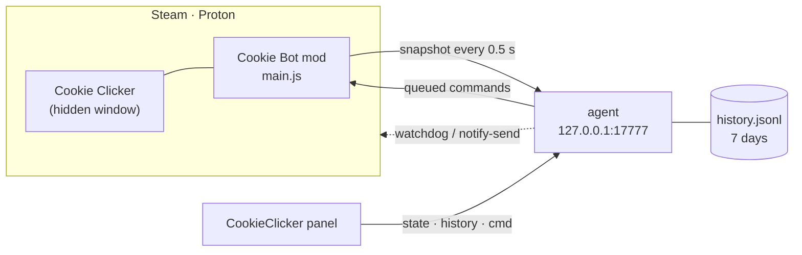

<div align="center">

[Русский](README.md) · **English**


# Cookie Bot

**A bot that plays Steam Cookie Clicker in the background and a terminal dashboard that lets you look in.**

The real game keeps running, hidden, so Steam keeps counting hours and achievements.<br>
You can open the panel, check how things are going, and close it again: the bot keeps playing.


</div>

<br>


## What it does

<table>
<tr>
<td width="50%" valign="top">

### 🍪 Plays the game
- Clicks 20 times a second, 50 during combos
- Pops golden cookies and reindeer, clicks fortunes
- Picks every purchase by its **real** CpS gain, computed with the game's own formulas
- Keeps a lucky bank for golden-cookie payouts
- Buys cheaper things while saving for a big one, if they pay off sooner

</td>
<td width="50%" valign="top">

### 🔮 Knows the minigames
- **Grimoire:** reads the seeded *Force the Hand of Fate* outcome (40/40 exact) and saves click frenzies for a Frenzy
- **Stock market:** buys low, sells high, hires brokers
- **Pantheon, garden, dragon, sugar lumps:** sensible defaults, all automatic

</td>
</tr>
<tr>
<td valign="top">

### ✨ Ascends at the right time
- Ascends when chip growth drops below the run's average (the marginal-value rule)
- Buys heavenly upgrades in a fixed order and pulls in missing parents
- Pops wrinklers first, waits for a running combo to end
- Refuses a reset that would earn 0 chips, in three places

</td>
<td valign="top">

### 🛡️ Runs unattended
- Background agent with a 7-day history
- Watchdog relaunches the game if it crashes
- Desktop notifications: ready to ascend, ascending, relaunching
- Steam hours and achievements keep counting

</td>
</tr>
</table>

## The panel

Six tabs in the style of the **DASH** theme: graphite, lowercase titles, amber only on what's active.

| | |
|:---:|:---:|
|  |  |
| **market:** gauge against resting value, P/L, sparklines | **minigames:** next spell outcomes, pantheon, garden grid, heaven plan |
|  |  |
| **charts:** income (log), chips, activity bars, CpS split, doubling time | **settings:** every module, arrows + space |

### Meet Clawd

The Claude Code mascot lives above the footer and puts on a costume on every tab. He follows the bot's real events: he hops on purchases, cheers on golden cookies and spells, sprints during combos and naps when the bot is off.

<div align="center">

</div>

## How it works



- **The mod** runs inside the game and does all the playing. It talks to the outside world over plain HTTP to `127.0.0.1`.
- **The agent** is a small Python process. It holds the link, stores history, sticks to one game instance (Steam beats a browser copy) and relaunches the game if it disappears.
- **The panel** is a curses client. Closing it, even with the terminal's close button, never touches the game.
- **`start.js` patch:** two small changes to the game's Electron entry point, applied by `install.sh` and reversible. Timers keep full speed while the window is hidden, and the mod can hide or show the window.

## Install

Linux with Steam and Proton, Python 3 (standard library only).

```sh
# 1. put the mod where the game looks for local mods
cd "$HOME/.local/share/Steam/steamapps/common/Cookie Clicker/resources/app/mods/local"
git clone https://github.com/d1sold/cookie-bot.git cookieBot

# 2. patch start.js and install the CookieClicker command (close the game first)
./cookieBot/install.sh

# 3. go
CookieClicker
```

Enable **Cookie Bot** once in the game's *Options → Mods* if it isn't already on. After a Steam update or *Verify integrity*, run `install.sh` again.

## Use

```sh
CookieClicker              # panel; starts the agent and the game if needed
CookieClicker status       # one-screen summary, then exit
CookieClicker show | hide  # game window
CookieClicker save | quit  # quit = save and fully close (watchdog stands down)
CookieClicker agent stop
```

| key | action | key | action |
|---|---|---|---|
| `1`–`6` / `Tab` | switch tab | `w` | show / hide the game window |
| `b` | bot on / off | `s` | save |
| `A` `A` | ascend now | `Q` `Q` | close the game and exit |
| `←` `→` | chart span | `q` / `Esc` | close the panel (game keeps going) |

Keys work in the Russian layout too (й = q, Й = Q, …).

## Measured, not guessed

`sim/sim.js` runs the real game logic and the real bot on a virtual clock, 200–500× faster than real time, starting from a copy of your save. After one warm-up run, runs with the same seed repeat exactly.

| experiment | runs | result | verdict |
|---|---|---|---|
| lucky bank **off** vs **6000 s** | 20 seeds × 1 h | ×0.56 · 7 wins / 13 losses | keep the bank |
| lucky bank **1500 s** vs **6000 s** | 20 seeds × 1 h | ×1.07 · t = 0.17 | no difference |
| milk-aware buying | 20 seeds × 0.5 h, early + late save | ×0.98 · t = −1.5 | shipped **off** |
| buy while saving | 1 pair × 400 game-min, fresh start | +1.9 % | shipped **on** |

Golden-cookie luck swings short runs by 10–50×, so every setting is judged over many seeds. The full log is in [`PLAN.md`](PLAN.md).

## FAQ

**Do Steam hours and achievements count?** Yes. The real game process runs under Steam and grants achievements through the game's own Steam integration.

**Is it a cheat?** It plays the game through the game's own functions: it never edits your cookies and never calls `Game.Win`. Two options peek at hidden state and are labelled: *see trends* (market) and *predict spells* (grimoire). Single-player only, so the only person affected is you.

**What does it change outside the mod folder?** The `start.js` patch (undo it with `python3 tui/patch_game.py --restore`), the `~/.local/bin/CookieClicker` command, and history in `~/.local/share/cookiebot/`.

**Windows?** Not yet. The game side would work, but the agent and panel assume Linux tools (`pgrep`, `steam`, `notify-send`).

## Layout

```
main.js, info.txt      the mod
tui/cookie_agent.py    background agent
tui/cookie_tui.py      CookieClicker panel + one-shot commands
tui/patch_game.py      start.js patch / restore
sim/sim.js             simulator
install.sh             re-patch + command
PLAN.md                work log, experiments, ideas
docs/                  screenshots
```

---

<sub>MIT licensed, see [LICENSE](LICENSE). Fan project, not affiliated with Orteil / DashNet (Cookie Clicker) or Anthropic. Clawd appears as a tribute to the Claude Code mascot. Built together with Claude Code.</sub>
