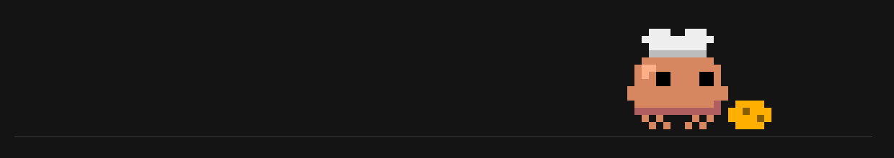
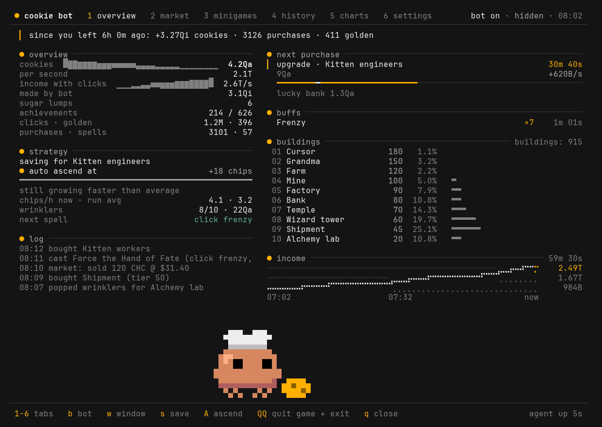
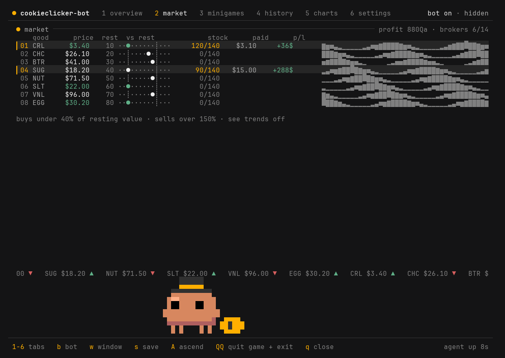
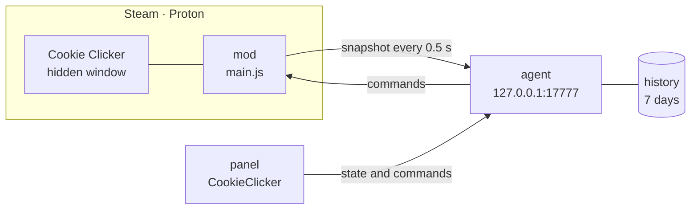

# CookieClicker-BOT

A bot plays Steam Cookie Clicker while the game window stays hidden. A terminal panel shows what it is doing. Steam keeps counting hours and granting achievements, because the real game is running.

`Linux` · `Steam + Proton` · `Python 3, no dependencies` · `MIT` · [Русский](README.md)



## What it does

### Plays

- Clicks 20 times a second, 50 during combos
- Pops golden cookies and reindeer, clicks news fortunes
- Picks each purchase by its real CpS gain, computed with the game's own formulas
- While saving for something expensive, buys what pays off sooner

### Minigames

- Grimoire: reads the seeded Force the Hand of Fate outcome and saves click frenzies for a Frenzy
- Stock market: buys below resting value, sells above it, hires brokers
- Pantheon, garden, dragon and sugar lumps run on their own

### Ascension

- Ascends when chips start arriving slower than the run's average
- Buys heavenly upgrades in a fixed order, missing parents included
- Pops wrinklers and waits for a running combo before it ascends
- Refuses to ascend for 0 chips

### Unattended

- A background agent keeps 7 days of history
- Relaunches the game through Steam if it crashes
- Sends notifications: ready to ascend, ascending, relaunching

## The panel

Six tabs in the DASH theme style: graphite, lowercase titles, amber only on what is active. Keys `1`–`6` switch tabs.

| | |
|---|---|
|  |  |
| `2` market | `3` minigames |
|  |  |
| `5` charts | `6` settings |

### Clawd

Clawd, the Claude Code mascot, lives above the bottom line. He follows the bot's events: hops on purchases, raises his arms on golden cookies and spells, runs during combos and sleeps when the bot is off. Each tab gives him a different job.


## How it works



- **The mod** runs inside the game and does the playing. It only talks HTTP to `127.0.0.1`
- **The agent** holds the link, keeps history and relaunches the game. If two copies of the game connect, it listens to the Steam one
- **The panel** only shows. Close it, even with the terminal's close button, and the game keeps going
- **The `start.js` patch** makes two changes to the game's launcher: timers keep full speed in a hidden window, and the mod can hide the window. `install.sh` applies it, one command reverts it

## Install

You need Linux, Steam with Proton and Python 3.

```sh
cd "$HOME/.local/share/Steam/steamapps/common/Cookie Clicker/resources/app/mods/local"
git clone https://github.com/d1sold/CookieClicker-BOT.git
./CookieClicker-BOT/install.sh   # close the game first
CookieClicker
```

If the mod doesn't turn on by itself, enable it in the game under Options → Mods. After a Steam update, run `install.sh` again.

## Commands and keys

```sh
CookieClicker              # panel; starts the agent and the game
CookieClicker status       # one-page summary
CookieClicker show | hide  # game window
CookieClicker save | quit  # quit saves and closes the game
CookieClicker agent stop
```

| key | action | key | action |
|---|---|---|---|
| `1`–`6` | tabs | `w` | show or hide the window |
| `b` | bot on/off | `s` | save |
| `A` `A` | ascend | `Q` `Q` | close the game and exit |
| `←` `→` | chart span | `q` | close the panel |

Keys also work in the Russian keyboard layout.

## Measurements

Settings are checked in the simulator, `sim/sim.js`. It runs the real game logic and the real bot 200–500× faster than real time, starting from a copy of a save.

| compared | runs | result | decision |
|---|---|---|---|
| lucky bank off vs 6000 s | 20 × 1 h | ×0.56, off won 7 of 20 | bank kept |
| lucky bank 1500 vs 6000 s | 20 × 1 h | ×1.07, t = 0.17 | no difference |
| milk-aware buying | 20 × 0.5 h, 2 saves | ×0.98, t = −1.5 | off |
| buying while saving | 1 × 400 min | +1.9 % | on |

Golden-cookie luck swings a short run by 10–50×, so comparisons use many seeds. Details are in [PLAN.md](PLAN.md).

## Questions

**Do Steam hours and achievements count?**
Yes. The real game process runs with its own Steam integration.

**Is it a cheat?**
The bot plays through the game's own functions: it never edits your cookie count and never grants achievements directly. Two options peek at hidden state and are named that way: see trends and predict spells. The game is single-player.

**What changes outside the mod folder?**
The game's `start.js` (revert: `python3 tui/patch_game.py --restore`), the `~/.local/bin/CookieClicker` command and history in `~/.local/share/cookiebot/`.

**Windows?**
Not yet. The agent and panel rely on `pgrep`, `steam` and `notify-send`.

## Files

```
main.js, info.txt      mod
tui/cookie_agent.py    agent
tui/cookie_tui.py      panel and commands
tui/patch_game.py      start.js patch and revert
sim/sim.js             simulator
install.sh             install and re-patch
PLAN.md                work log and measurements
```

<sub>MIT, see [LICENSE](LICENSE). Fan project, not affiliated with Orteil / DashNet or Anthropic. Clawd is drawn as a tribute to the Claude Code mascot.</sub>
