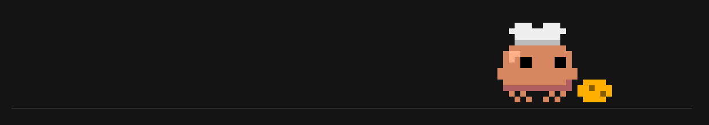
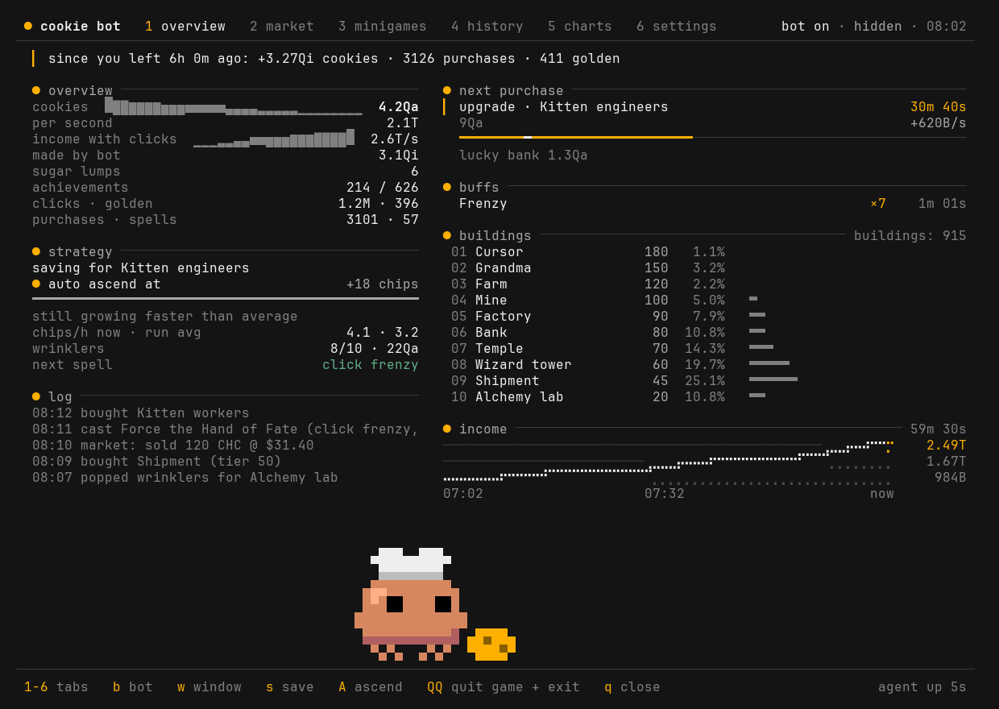
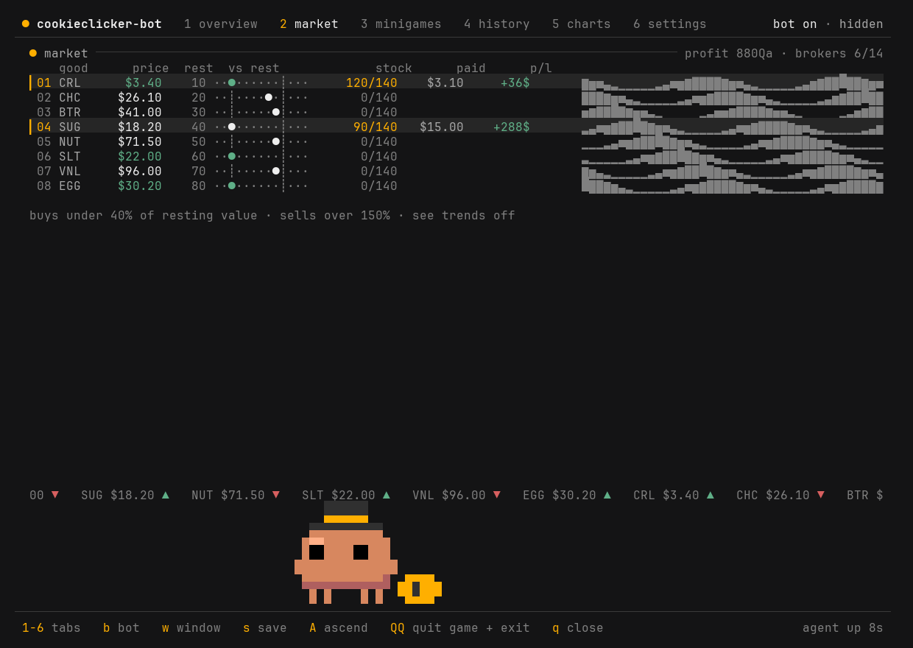
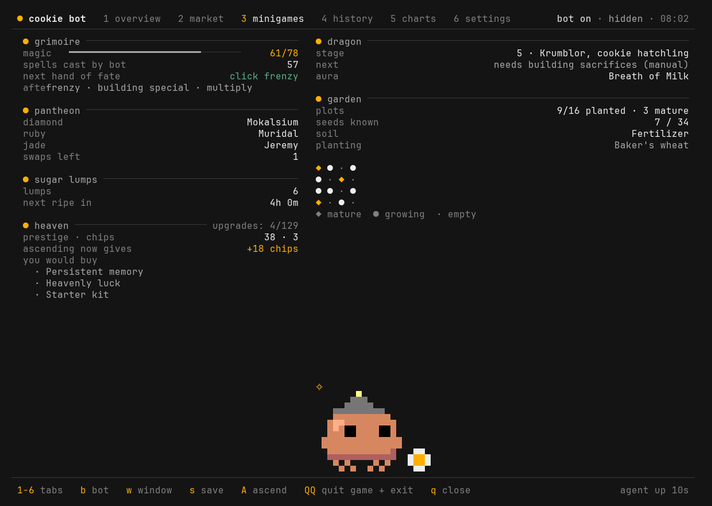
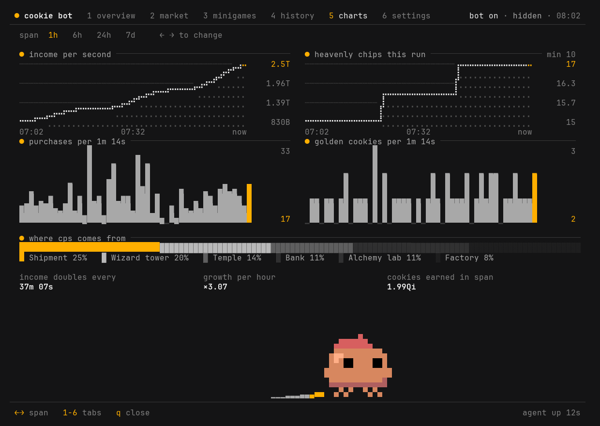
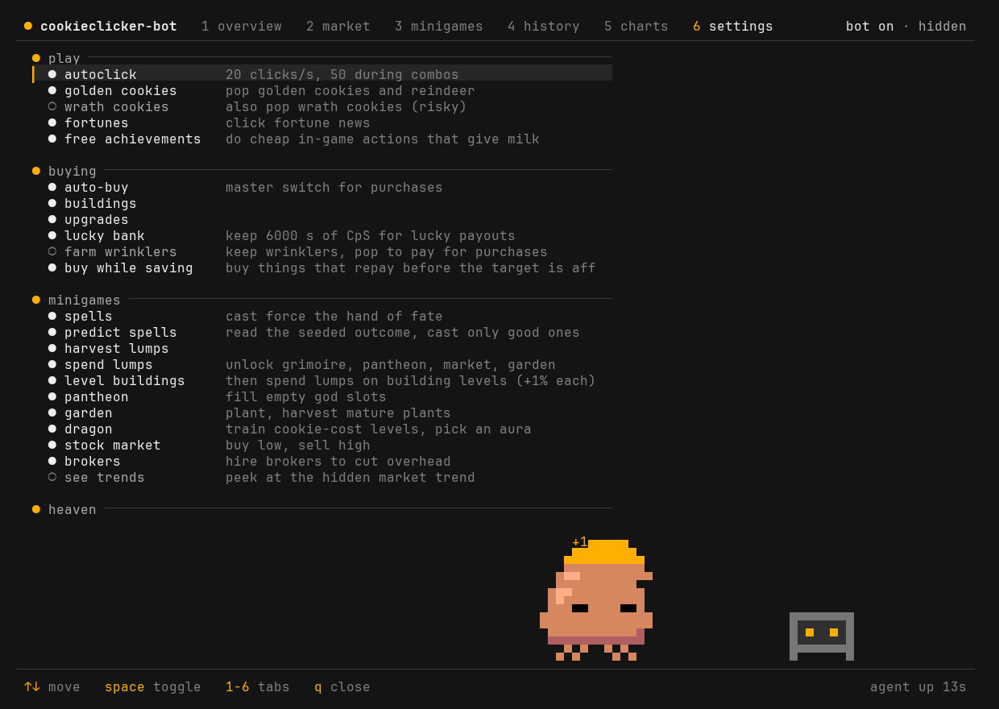
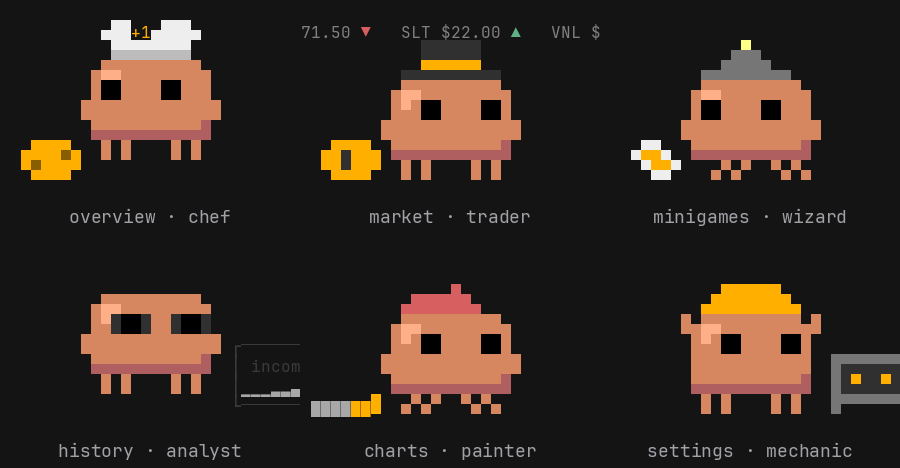
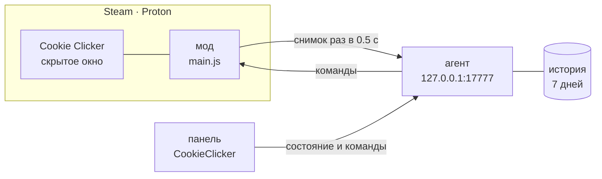

# CookieClicker-BOT

Бот играет в Cookie Clicker из Steam, пока окно игры скрыто. Терминальная панель показывает, что он делает. Steam при этом считает часы и выдаёт ачивки, потому что работает настоящая игра.

`Linux` · `Steam + Proton` · `Python 3 без зависимостей` · `MIT` · [English](README.en.md)



## Что он делает

### Играет

- Кликает 20 раз в секунду, во время комбо 50
- Ловит золотые печеньки, оленей и предсказания в новостях
- Выбирает покупку по реальному приросту дохода, посчитанному формулами самой игры
- Пока копит на дорогую вещь, покупает то, что окупится раньше

### Мини-игры

- Гримуар: читает исход «Руки судьбы» по сиду игры и придерживает Click frenzy до Frenzy
- Биржа: покупает ниже нормы, продаёт выше, нанимает брокеров
- Пантеон, сад, дракон и сахарные кубики настраиваются сами

### Вознесение

- Возносится, когда фишки начинают прибывать медленнее, чем в среднем за забег
- Покупает небесные апгрейды в заданном порядке вместе с недостающими родителями
- Перед вознесением лопает морщинников и дожидается конца комбо
- Не даёт вознестись за 0 фишек

### Без присмотра

- Фоновый агент хранит историю за 7 дней
- Если игра упала, перезапускает её через Steam
- Присылает уведомления: можно возноситься, вознесение, перезапуск

## Панель

Шесть вкладок в стиле темы DASH: графит, подписи строчными, янтарь только на активном. Клавиши `1`–`6` переключают вкладки.

| | |
|---|---|
|  |  |
| `2` биржа | `3` мини-игры |
|  |  |
| `5` графики | `6` настройки |

### Clawd

Над нижней строкой живёт Clawd, маскот Claude Code. Он реагирует на события бота: прыгает на покупках, поднимает руки на золотых печеньках и заклинаниях, бегает во время комбо и спит, когда бот выключен. На каждой вкладке у него своя роль.



## Как устроено



- **Мод** работает внутри игры и играет. Наружу говорит по HTTP только с `127.0.0.1`
- **Агент** держит связь, хранит историю и перезапускает игру. Если подключились две копии игры, слушает Steam-версию
- **Панель** только показывает. Её можно закрыть даже крестиком терминала, игра продолжит
- **Патч `start.js`** вносит две правки в запуск игры: таймеры не замедляются в скрытом окне, мод может скрыть окно. Ставится `install.sh`, откатывается одной командой

## Установка

Нужны Linux, Steam с Proton и Python 3.

```sh
cd "$HOME/.local/share/Steam/steamapps/common/Cookie Clicker/resources/app/mods/local"
git clone https://github.com/d1sold/CookieClicker-BOT.git
./CookieClicker-BOT/install.sh   # закрой игру перед запуском
CookieClicker
```

Если мод не включился сам, включи его в игре: Options → Mods. После обновления игры в Steam снова запусти `install.sh`.

## Команды и клавиши

```sh
CookieClicker              # панель, сама запустит агента и игру
CookieClicker status       # сводка в одну страницу
CookieClicker show | hide  # окно игры
CookieClicker save | quit  # quit сохраняет и закрывает игру
CookieClicker agent stop
```

| клавиша | действие | клавиша | действие |
|---|---|---|---|
| `1`–`6` | вкладки | `w` | показать или скрыть окно |
| `b` | бот вкл/выкл | `s` | сохранить |
| `A` `A` | вознестись | `Q` `Q` | закрыть игру и выйти |
| `←` `→` | период графиков | `q` | закрыть панель |

Клавиши работают и в русской раскладке.

## Замеры

Настройки проверены в симуляторе `sim/sim.js`. Он гоняет настоящую логику игры и бота в 200–500 раз быстрее реального времени, начиная с копии сейва.

| что сравнивали | прогоны | итог | решение |
|---|---|---|---|
| Lucky-банк выкл / 6000 с | 20 × 1 ч | ×0.56, выкл выиграл 7 из 20 | банк оставлен |
| Lucky-банк 1500 / 6000 с | 20 × 1 ч | ×1.07, t = 0.17 | разницы нет |
| учёт ачивок при покупках | 20 × 0.5 ч, 2 сейва | ×0.98, t = −1.5 | выключено |
| покупки во время накопления | 1 × 400 мин | +1.9 % | включено |

Удача с золотыми печеньками меняет короткий прогон в 10–50 раз, поэтому сравнение идёт по многим сидам. Подробности в [PLAN.md](PLAN.md).

## Вопросы

**Считаются ли часы и ачивки в Steam?**
Да. Работает настоящий процесс игры со своей интеграцией Steam.

**Это чит?**
Бот играет функциями самой игры: не меняет число печенек и не выдаёт ачивки напрямую. Две опции подглядывают в скрытое состояние и так и названы: see trends и predict spells. Игра одиночная.

**Что меняется вне папки мода?**
`start.js` игры (откат: `python3 tui/patch_game.py --restore`), команда `~/.local/bin/CookieClicker` и история в `~/.local/share/cookiebot/`.

**Будет ли Windows?**
Пока нет. Агент и панель используют `pgrep`, `steam` и `notify-send`.

## Файлы

```
main.js, info.txt      мод
tui/cookie_agent.py    агент
tui/cookie_tui.py      панель и команды
tui/patch_game.py      патч и откат start.js
sim/sim.js             симулятор
install.sh             установка и повторный патч
PLAN.md                журнал работы и замеры
```

<sub>MIT, см. [LICENSE](LICENSE). Фан-проект, не связан с Orteil / DashNet и Anthropic. Clawd нарисован в честь маскота Claude Code.</sub>
