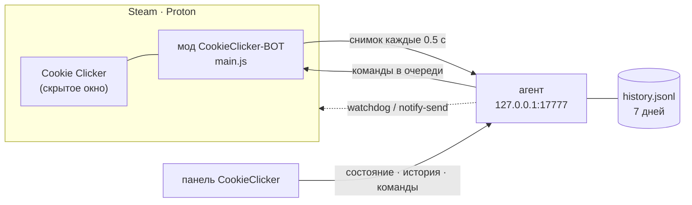

<div align="center">

**Русский** · [English](README.en.md)


# CookieClicker-BOT

**Бот, который сам играет в Cookie Clicker из Steam в фоне, и терминальная панель, через которую за ним можно подглядывать.**

Настоящая игра продолжает работать в скрытом окне, поэтому Steam считает часы и выдаёт ачивки.<br>
Открыл панель, посмотрел, как дела, закрыл. Бот продолжает играть.


</div>

<br>


## Что он умеет

<table>
<tr>
<td width="50%" valign="top">

### 🍪 Играет
- Кликает 20 раз в секунду, во время комбо 50
- Ловит золотые печеньки и оленей, кликает предсказания в новостях
- Каждую покупку выбирает по **реальному** приросту дохода, который пересчитывает формулами самой игры
- Держит Lucky-банк под выплаты золотых печенек
- Пока копит на дорогую покупку, берёт то, что окупится раньше

</td>
<td width="50%" valign="top">

### 🔮 Разбирается в мини-играх
- **Гримуар:** читает заранее заданный сидом исход «Руки судьбы» (совпало 40 из 40) и придерживает Click frenzy до Frenzy
- **Биржа:** покупает дёшево, продаёт дорого, нанимает брокеров
- **Пантеон, сад, дракон, сахарные кубики:** разумные настройки, всё само

</td>
</tr>
<tr>
<td valign="top">

### ✨ Возносится вовремя
- Возносится, когда небесные фишки начинают прибывать медленнее, чем в среднем за забег (правило предельной ценности)
- Покупает небесные апгрейды в заданном порядке и сам подтягивает недостающих «родителей» в дереве
- Перед вознесением лопает морщинников и ждёт конца комбо
- Не даёт вознестись за 0 фишек: защита стоит в трёх местах

</td>
<td valign="top">

### 🛡️ Работает без присмотра
- Фоновый агент хранит историю за 7 дней
- Если игра упала, watchdog запускает её заново
- Уведомления на рабочий стол: «можно возноситься», «вознесение», «перезапуск игры»
- Часы и ачивки в Steam продолжают идти

</td>
</tr>
</table>

## Панель

Шесть вкладок в стиле темы **DASH**: графит, подписи строчными, янтарь только на активном.

| | |
|:---:|:---:|
|  |  |
| **market:** цена относительно нормы, прибыль и убыток, мини-графики | **minigames:** следующие исходы заклинаний, Пантеон, сетка сада, план на небе |
|  |  |
| **charts:** доход (лог-шкала), фишки, столбики активности, доли зданий, время удвоения | **settings:** все модули, стрелки и пробел |

### Знакомьтесь, Clawd

Маскот Claude Code живёт над нижней строкой панели и на каждой вкладке переодевается. Он реагирует на настоящие события бота: подпрыгивает при покупках, поднимает руки на золотых печеньках и заклинаниях, носится во время комбо и спит, когда бот выключен.

<div align="center">

</div>

## Как это устроено



- **Мод** работает внутри игры и делает всю игру. С внешним миром говорит по обычному HTTP на `127.0.0.1`.
- **Агент** — маленький процесс на Python. Держит связь, хранит историю, держится за одну копию игры (Steam важнее браузерной) и перезапускает игру, если та пропала.
- **Панель** — клиент на curses. Её закрытие, даже крестиком терминала, игру не трогает.
- **Патч `start.js`:** две маленькие правки во входной точке Electron-игры, ставятся `install.sh` и откатываются. Таймеры не замедляются, пока окно скрыто, а мод может прятать и показывать окно.

## Установка

Linux со Steam и Proton, Python 3 (только стандартная библиотека).

```sh
# 1. положить мод туда, где игра ищет локальные моды
cd "$HOME/.local/share/Steam/steamapps/common/Cookie Clicker/resources/app/mods/local"
git clone https://github.com/d1sold/CookieClicker-BOT.git

# 2. пропатчить start.js и поставить команду CookieClicker (игру сначала закрыть)
./CookieClicker-BOT/install.sh

# 3. поехали
CookieClicker
```

Если мод не включился сам, один раз включи **CookieClicker-BOT** в игре: *Options → Mods*. После обновления игры в Steam или «Проверки целостности файлов» запусти `install.sh` ещё раз.

## Как пользоваться

```sh
CookieClicker              # панель; сама запустит агента и игру
CookieClicker status       # короткая сводка в терминал
CookieClicker show | hide  # показать / скрыть окно игры
CookieClicker save | quit  # quit = сохранить и полностью закрыть (watchdog отступает)
CookieClicker agent stop
```

| клавиша | действие | клавиша | действие |
|---|---|---|---|
| `1`–`6` / `Tab` | вкладки | `w` | показать / скрыть окно игры |
| `b` | бот вкл / выкл | `s` | сохранить |
| `A` `A` | вознестись сейчас | `Q` `Q` | закрыть игру и выйти |
| `←` `→` | период графиков | `q` / `Esc` | закрыть панель (игра работает дальше) |

Клавиши работают и в русской раскладке (й = q, Й = Q, …).

## Замерено, а не на глаз

`sim/sim.js` гоняет настоящую логику игры и настоящего бота на виртуальных часах, в 200–500 раз быстрее реального времени, начиная с копии твоего сейва. После одного разогревочного прогона прогоны с одинаковым сидом повторяются в точности.

| эксперимент | прогоны | результат | решение |
|---|---|---|---|
| Lucky-банк **выкл** против **6000 с** | 20 сидов × 1 ч | ×0.56 · 7 побед / 13 поражений | банк оставить |
| Lucky-банк **1500 с** против **6000 с** | 20 сидов × 1 ч | ×1.07 · t = 0.17 | разницы нет |
| учёт ачивок при покупках | 20 сидов × 0.5 ч, ранний и поздний сейв | ×0.98 · t = −1.5 | выключено |
| покупки во время накопления | 1 пара × 400 игровых минут с нуля | +1.9 % | включено |

Удача с золотыми печеньками раскачивает короткие прогоны в 10–50 раз, поэтому каждая настройка проверяется на многих сидах. Полный лог работы — в [`PLAN.md`](PLAN.md).

## Вопросы

**Считаются ли часы и ачивки в Steam?** Да. Настоящий процесс игры работает под Steam и выдаёт ачивки через собственную интеграцию игры со Steam.

**Это чит?** Бот играет через функции самой игры: печеньки не редактирует и `Game.Win` не вызывает. Две опции подглядывают в скрытое состояние и так и подписаны: *see trends* (биржа) и *predict spells* (Гримуар). Игра одиночная, так что затрагивает это только тебя.

**Что меняется за пределами папки мода?** Патч `start.js` (откат: `python3 tui/patch_game.py --restore`), команда `~/.local/bin/CookieClicker` и история в `~/.local/share/cookiebot/`.

**А Windows?** Пока нет. Сторона игры заработала бы, но агент и панель рассчитаны на инструменты Linux (`pgrep`, `steam`, `notify-send`).

## Что где лежит

```
main.js, info.txt      мод
tui/cookie_agent.py    фоновый агент
tui/cookie_tui.py      панель CookieClicker и разовые команды
tui/patch_game.py      патч / откат start.js
sim/sim.js             симулятор
install.sh             повторный патч и команда
PLAN.md                лог работы, эксперименты, идеи
docs/                  скриншоты
```

---

<sub>Лицензия MIT, см. [LICENSE](LICENSE). Фан-проект, не связан с Orteil / DashNet (Cookie Clicker) и Anthropic. Clawd здесь как дань уважения маскоту Claude Code. Сделано вместе с Claude Code.</sub>
